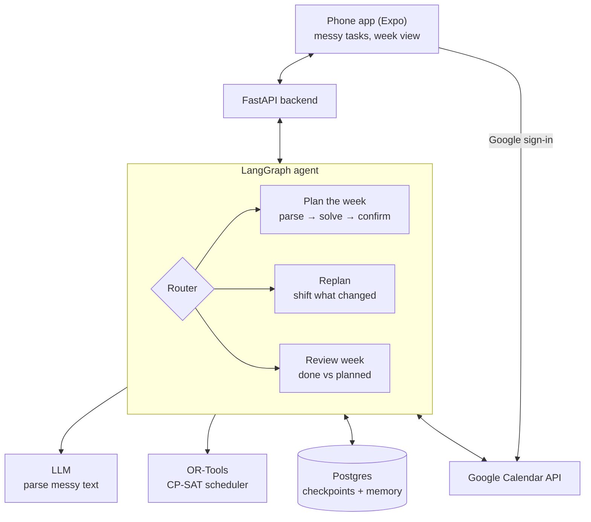

# Weekly Planning Agent

An AI agent that turns a messy brain-dump of tasks into a realistic weekly schedule, syncs it with your calendar, and adapts when the week changes. It comes with a fun mobile app.

> Example input: *"Exam Friday, two reports due Thursday, want gym 3 times, Wednesday afternoon is gone, call mom sometime."*
> Output: a week of time blocks that respects deadlines, existing events and preferences, ready to approve and push to Google Calendar.

---

## 1. Goals

- **Messy in, clean out:** users type naturally; the agent figures out tasks, durations, deadlines and priorities.
- **Reliable plans:** no overlaps, no missed deadlines, and no "AI math" mistakes.
- **Human in the loop:** the agent proposes, and the user approves or adjusts before anything is written to the calendar.
- **Adapts mid-week:** "I lost Wednesday afternoon" reshuffles the plan without breaking deadlines.
- **Fun to use:** a playful mobile UI, not another boring to-do list.

**Start small.** The first version focuses on planning one week for one user, end to end.

---

## 2. Key design decisions

| Decision | Choice | Why |
|---|---|---|
| Who decides the schedule | **Hybrid**: the LLM understands text, a solver places tasks | LLMs are great with language but unreliable at constraint math; a solver guarantees valid plans |
| Agent framework | **LangGraph** | Explicit state graph, easy to debug, built-in human-in-the-loop (`interrupt`) and checkpointing |
| Agent structure | **Router + subgraphs** | Each request type gets its own focused flow; it scales cleanly and splits well across a team |
| Memory and state | **Postgres** | One database for LangGraph checkpoints (paused conversations) and long-term user memory |
| Scheduling engine | **OR-Tools CP-SAT** | Free, fast constraint solver; handles deadlines, no-overlap and priorities |
| Calendar | **Google Calendar API** | Most common; read existing events, write approved plans |
| Front end | **Mobile app** (Expo / React Native recommended) | One codebase for Android and iOS, testable on a phone via QR code, good animation libraries |

---

## 3. Architecture



### Request flow
1. The user types or dictates their tasks in the app.
2. The app sends the text to the **FastAPI** backend.
3. The **router** classifies the request and sends it to the right **subgraph**.
4. The subgraph uses the **LLM** to extract structured tasks, and **OR-Tools** to place them into free time.
5. The agent **pauses** and shows the proposed plan in the app.
6. The user approves or asks for changes (which loops back to step 4).
7. On approval, the plan is written to **Google Calendar**, and state is saved in **Postgres**.

---

## 4. Components

### 4.1 Router
A small LLM call (or classifier) that labels each message:

| Intent | Example | Goes to |
|---|---|---|
| `plan_week` | "Here's everything I need to do this week…" | Plan subgraph |
| `replan` | "Move gym to Thursday", "I'm sick today" | Replan subgraph |
| `review` | "How did my week go?" | Review subgraph |
| `question` *(later)* | "What's left for today?" | Answer from state |

### 4.2 Plan-the-week subgraph
```
load_context → parse → schedule → [unscheduled?] → negotiate ↺
                                 → confirm → commit
```
- **load_context:** fetch calendar events and user preferences.
- **parse (LLM):** structured output turns text into a list of tasks `{title, duration, deadline, priority}` plus blocked times.
- **schedule (solver):** place task sessions into free slots.
- **negotiate (human in the loop):** if something doesn't fit, ask the user to drop it, shorten it, or move its deadline.
- **confirm (human in the loop):** show the plan; the user approves or gives feedback.
- **commit:** write to Google Calendar.

### 4.3 Replan subgraph
Takes the current plan plus a change, frees or blocks the affected time, and re-runs the solver. It keeps already-completed and unaffected blocks fixed where possible, so the week doesn't get completely reshuffled.

### 4.4 Review subgraph
At the end of the week it compares planned vs. done, records how long tasks really took, and updates user memory, so future duration estimates get better.

### 4.5 Scheduler (OR-Tools CP-SAT)
- **Hard constraints:** no overlap with events or each other, sessions finish before their deadline, everything stays inside working hours.
- **Long tasks** are split into sessions (e.g. max 2h each).
- **Objective:** maximize scheduled priority-weighted hours.
- **To add next:** a daily hour cap, rewards for spreading work across days, preferred times ("deep work in the morning"), and breaks between sessions.

### 4.6 Memory (Postgres)
| Layer | What | Where |
|---|---|---|
| Short-term | Graph state for an in-progress conversation (e.g. waiting for approval) | LangGraph Postgres checkpointer |
| Long-term | Preferences, working hours, habits | `user_preferences` table |
| Learning | Estimated vs. actual task durations | `task_history` table |

### 4.7 Backend (FastAPI)
Example endpoints:
- `POST /plan` sends messy text and returns a proposed plan (or a question)
- `POST /resume` sends the user's answer to an agent pause
- `GET /week` returns the current plan
- `POST /auth/google` handles calendar connection

### 4.8 Mobile app
- A text (and later voice) box for the brain-dump
- An animated week view: tasks "fall into" time blocks
- Approve, tweak, or chat-to-change the plan
- Later: drag a block to move it so the agent reshuffles the rest; a weekly review card with streaks and a score; a playful assistant personality

---

## 5. Tech stack

| Layer | Tools |
|---|---|
| Agent | LangGraph, LangChain, an LLM with tool calling and structured output |
| Optimization | Google OR-Tools (CP-SAT) |
| Backend | Python, FastAPI, Pydantic |
| Database | PostgreSQL (`langgraph-checkpoint-postgres`) |
| Integrations | Google Calendar API (OAuth 2.0) |
| Mobile | Expo / React Native (alternatives: Flutter, a PWA) |
| Observability *(optional)* | LangSmith or Langfuse |

---

## 6. Roadmap

| Phase | Deliverable |
|---|---|
| **1. Agent core** | Plan-the-week subgraph working in the terminal; LLM parsing and the CP-SAT scheduler |
| **2. Persistence and API** | Postgres checkpointer and memory tables; FastAPI endpoints |
| **3. Router** | Router plus replan subgraph |
| **4. Mobile MVP** | Expo app: text box → plan list → approve |
| **5. Calendar** | Google Calendar read/write (start with one account, then per-user OAuth) |
| **6. Fun layer** | Animations, drag-to-move week view, review subgraph and weekly review screen |

---

## 7. Suggested team split

- **Agent and orchestration:** router, subgraphs, prompts, state design
- **Optimization:** CP-SAT model, constraints, objective tuning
- **Backend and data:** FastAPI, Postgres schema, Google Calendar integration
- **Mobile and UX:** Expo app, animations, the fun stuff
- **Everyone:** an evaluation set of realistic "messy weeks"

---

## 8. Evaluation

Build a set of 20–30 realistic messy weekly inputs and measure:
- **Parsing accuracy:** did the LLM extract the right tasks, deadlines and durations?
- **Plan validity:** overlaps and missed deadlines (should always be 0)
- **Coverage:** percentage of task hours scheduled
- **User effort:** number of correction rounds before approval
- **Latency:** time from input to proposed plan

---

## 9. Open questions

- Which LLM provider and model?
- Fixed sessions vs. flexible splitting for long tasks?
- How to handle recurring habits (gym 3x/week) vs. one-off tasks?
- Voice input in the MVP or later?
- Single user (demo) vs. multi-user from the start?
- Deadline and scope: course project, demo, or ongoing side project?